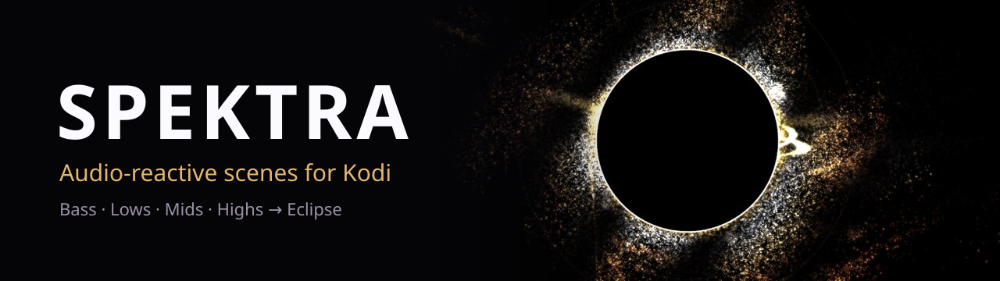
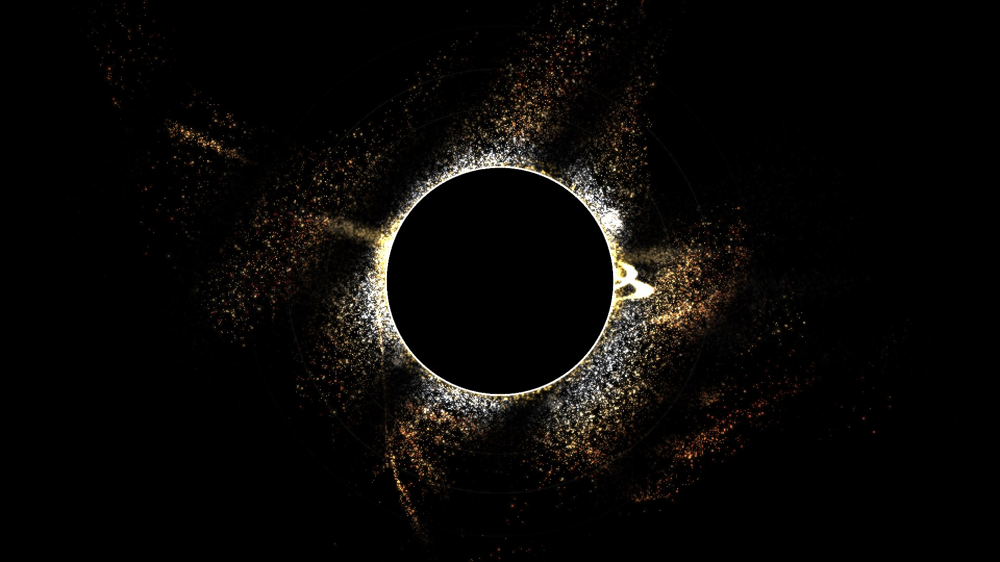

# Spektra

**Audio-reactive scenes for Kodi. Spektra splits your music into bass, lows, mids and highs
and lets each band drive its own part of the picture.**

The first scene is **Eclipse**: a digital solar eclipse. A black disc with a white rim, a flame
made of pixel dust burning all around it, free dust drifting away in a shared flow field, waves
born from the ring on every kick, and a warm corona with streamers and magnetic arcs that comes
with the melody and fades without it.



---

## Requirements

| | |
|---|---|
| Device | Raspberry Pi 5 (aarch64) |
| System | LibreELEC 12 with Kodi 21 “Omega” |
| Other | nothing – no Docker, no compiler on the device |

The add-on ships a library built for ARM64. It does not run on other platforms without
rebuilding.

## Installation

1. Build the zip (see [Building](#building)) or take it from a
   [release](https://github.com/willheisenberg/visualization-spektra/releases), and copy it to the
   Pi, e.g. to `/storage/downloads`.
2. In Kodi, allow **Settings → System → Add-ons → Unknown sources** once.
3. **Add-ons → Install from zip file** and pick the zip.
4. Set **Settings → Player → Music → Visualisation** to *Spektra*.

From the next track on, Spektra opens the full-screen visualisation by itself.

## Using it

- **Automatic opening:** when music starts, Spektra switches to the visualisation, hides the
  track info and returns there after three seconds without input in the home screen or music
  views. It never takes over settings or dialogs, and only acts while Spektra is the selected
  visualisation.
- **Menu:** *Add-ons → Program add-ons → Spektra* (or *Open menu* in the settings) turns
  Spektra on or off, opens the settings and shows the status.
- **Settings** (all take effect live, every one has a default you can return to):

| Group | Setting | Default |
|---|---|---|
| General | Spektra on, open automatically when music starts | on, on |
| General | Scene | Eclipse |
| General | Music intensity (1–100 %) – how strongly the music reaches the picture | 70 % |
| Eclipse | Flame, waves, free particles, corona (0–100 % each) | 100 % |
| Eclipse | Pixel size: 0.5× (fine dust) … 8× (coarse blocks) | 1× |
| Eclipse | Drop effect – a kick after a bass-less passage fires everything at once | on |
| Eclipse: mapping | which band drives which effect (any combination) | see below |
| Performance | Particle limit (10 000–60 000) | 42 000 |
| General | Reset everything to default | – |

### Default mapping

| Band | Typical in music | Level drives | Hits trigger |
|---|---|---|---|
| **Bass** 25–120 Hz | kick, sub | ring breathing | a wave born from the ring |
| **Lows** 120–500 Hz | bassline, groove | flame height all around | single flame jets |
| **Mids** 500 Hz–3 kHz | melody, chords, voice | corona strength | flame burst all around, streamers and arcs where the pitch is (low notes at the bottom, high notes at the top) |
| **Highs** 3–16 kHz | hi-hats, snares, air | dust breaking free, flow and shimmer speed | dust bursts |

Levels are measured relative to the song itself (its own average over the last seconds), so a
quiet ambient track looks as alive as a loud techno track.

### Other add-ons

Another add-on that plays sound which is not music (e.g. a call) can stop the automatic opening
by setting the home window property `spektra.suppress` while its sound runs.
`partyvideo.suppress` is honoured as well. Spektra and
[Party Video](https://github.com/willheisenberg/visualization-partyvideo) can be installed side
by side; only the selected visualisation opens itself.

## Remote control (JSON-RPC)

Spektra can be controlled through Kodi's JSON-RPC, e.g. from a chat bot:

```json
{"jsonrpc":"2.0","id":1,"method":"Addons.ExecuteAddon","params":{"addonid":"visualization.spektra","params":["action=set","key=intensity","value=40"]}}
```

Actions: `on`, `off`, `toggle`, `set` (any setting, plus `key=route.<effect> value=bass+high`),
`reset`, `scene`, `status`, `menu`. The result arrives as `Other.spektra_status` on Kodi's
WebSocket and in the home window properties `spektra.*`. Full reference (German):
[docs/bot-api.md](docs/bot-api.md).

## How it works

- **Analysis (C++):** Kodi hands the visualisation the playing audio. Spektra runs a 4096-point
  FFT with a Blackman window and the same smoothing and dB mapping as a browser's WebAudio
  analyser, then derives four band levels, hits (onsets), the pitch centre of the mids, overall
  intensity and drops.
- **Scene (C++):** Eclipse simulates the flame (240 cells), dust and corona particles on the CPU
  and describes each frame as a draw list. It knows neither Kodi nor OpenGL and is unit tested.
- **Renderer (OpenGL ES 3):** draws the list – the soft corona at fixed half resolution, bloom
  by halving twice, the black hole on top – and restores Kodi's GL state afterwards.
- **Service (Python):** opens the visualisation, handles commands and writes the settings to a
  small `live.json` the renderer picks up within a second.

The scene was designed as an interactive browser prototype first; the final version is kept in
[docs/entwuerfe/dune-v14-favorit.html](docs/entwuerfe/dune-v14-favorit.html) and is the
reference for every number in the C++ code.

## Building

Everything builds in Docker (Debian Bookworm with the aarch64 cross toolchain and Kodi 21.3's
add-on build system):

```bash
./build.sh    # add-on zip -> dist/
./test.sh     # ruff, Python tests, build script tests, C++ tests (GoogleTest), then the build
```

`./test.sh` needs a local virtual environment with ruff once:
`python3 -m venv .venv && .venv/bin/pip install ruff`.

The icon, fanart and this banner are generated from [assets/](assets/) with
`tools/make_media.py` (needs `rsvg-convert` and ImageMagick).

## Project layout

| Path | Content |
|---|---|
| `src/core/` | FFT, spectrum, analyser, settings, routing, state files, engine |
| `src/scene/` | scene interface, draw list, Eclipse (flame, dust, corona) |
| `src/gl/` | OpenGL ES renderer |
| `src/addon.cpp` | Kodi visualisation instance |
| `visualization.spektra/` | add-on files: manifest, settings, texts, Python service and menu |
| `tests/` | C++, Python and build script tests |
| `docs/` | design spec, implementation plans, bot API, browser prototypes |

## License

GPL-2.0-or-later, see [LICENSE](LICENSE).
